# dsh-glass-effort-slider

给 [DeepSeek Harness](https://github.com/deepseek-ai/deepseek-harness)（DSH）用的 **玻璃状推理等级条（Glass Reasoning Effort）**：把官方模型菜单里的「推理等级」那一行，改造成一条连续可拖的档位条（造型参照 Codex 的档位滑条）。

**一档一色、越往右越"通电"**：填充从蓝渐变到紫罗兰，高档位亮起紫色星云与星尘粒子，
连官方那一行的数值文字也跟着变色（`Off` 档保持官方灰）。

**松手吸附 + 弹性落档**：拖动中连续跟手（不吸附），松手后自动吸附到**最近档位**，
并带一次回弹（冲过刻度约 10%×行程再弹回来，420ms）；系统开了「减少动态效果」时缩到 180ms 且不回弹。

**键盘 / 滚轮也能调**：`←`/`→` 与滚轮**一档一档**走（到端点钳住、**不环绕**），
`↑`/`↓` 在 **Flash ↔ Pro** 之间切模型（不动档位）；`Home`/`End` 跳两端。

**那颗表示当前档位的珠子是 iOS 26 式液态玻璃、而且是"活"的**：**没有** `backdrop-filter`
（不糊背景，填充边界在珠子里仍然是锐利的）、珠体几乎空（白 ≤.16）、玻璃感来自"大柔光 + 小亮斑"
的曲面高光与内侧 1px 折射亮边 + 底部透射光弧 + 深色主题的边缘冷紫辉；拖得越快横向拉得越长、
落档冲过刻度会"叮"一下、高光慢半拍地跟着晃；见
[`preview/knob-glass.png`](preview/knob-glass.png)。

## 装好之后长这样（真机截图）

收起态：档位就在输入框里那枚模型席按钮上，**点开之前**也按档位着色。

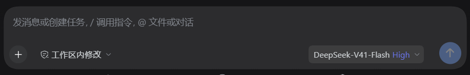

点开模型菜单后（左列浅色主题 / 右列深色主题，四档从上到下）：

| 档位 | 浅色主题 | 深色主题 |
|---|---|---|
| **Max** | 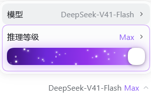 | 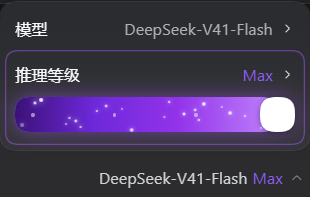 |
| **High** | 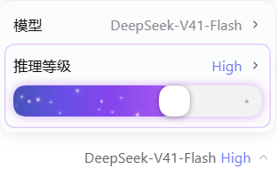 | 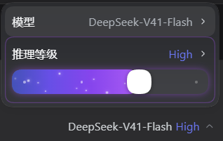 |
| **Low** | 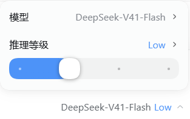 | 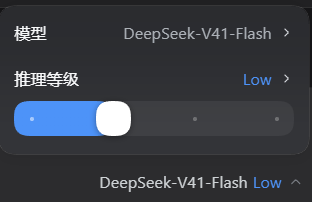 |
| **Off** | 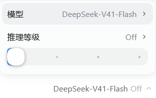 | 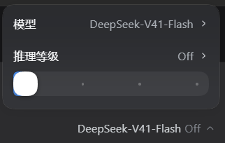 |

对比度都算过（最高档的数值文字：白底 **4.23:1**、深色底 **4.02:1**）。
**不用安装也能先玩**：浏览器打开 [`preview/panel.html`](preview/panel.html)，可拖动、可滚轮、可按键、可切 Flash/Pro、
切浅深色、切 4/2/6 档模型
（另有脚本生成的实现示意图：[`preview/seat-color.png`](preview/seat-color.png)、[`preview/distribution.png`](preview/distribution.png)；落档动画见 [`preview/snap-frames.png`](preview/snap-frames.png)）。

它不新增入口：**直接改造官方模型菜单里的「推理等级」那一行** ——
那一行被加高上下内距、允许折行，滑条作为第二行铺满整行宽度；拖到最高档时整条轨道亮起紫色能量层。

```
点开官方模型菜单后：
┌────────────────────────────────────┐
│ 模型             DeepSeek-V41-Flash › │   ← 官方原样
├────────────────────────────────────┤
│ 推理等级                       Max › │   ← 官方原样（label / value / chevron 一个没动）
│ ●━━━━━━━━━━━━━━━━━━━━━━━━━━━━━━━    │   ← 插件注入的滑条（这一行因此被加高）
└────────────────────────────────────┘
输入框工具行：**不加任何东西**（没有胶囊、没有浮层）
```

拖到最高档：轨道变为**紫色星云**（流向渐变 + 扫光 + 22 颗错峰星尘粒子），那一行同时描一圈紫边。

松手时的**吸附**是"最近档位"（四舍五入到刻度），**回弹**是 easeOutBack 曲线：越过分界就往上吸、
冲过刻度一点点再弹回来，最后**精确**停在刻度上。下图是同一段落档的两个视角（曲线是时间上的形状，
胶片是像素上的样子）——曲线、几何、配色全部抽自 `lib/client.js`，图里没有第二份数学：

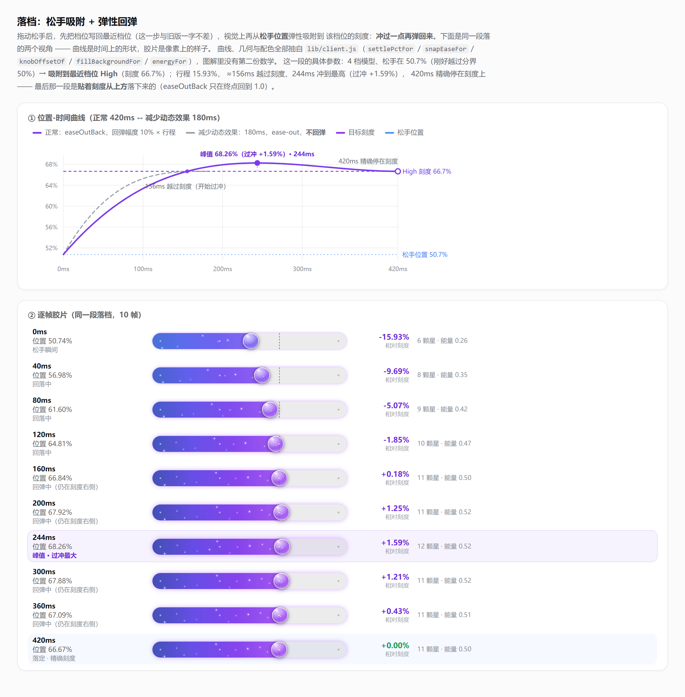

**30 秒上手**：`git clone https://github.com/Herobrine-ZXY/dsh-glass-effort-slider`（或从
[Releases](https://github.com/Herobrine-ZXY/dsh-glass-effort-slider/releases) 下 zip 解压）
→ 双击 `install.cmd`（或按下面的「安装」一节）→ **完全退出并重开** DSH Desktop。

## 安装

> 不想 clone 的话，直接下 [Releases](https://github.com/Herobrine-ZXY/dsh-glass-effort-slider/releases)
> 里的 **`dsh-glass-effort-slider-<version>.zip`**（解压得到一个目录，结构与本仓库一致）。

**只走 DSH Desktop 自己的插件面板**——命令行装不了 `desktop` profile：

```powershell
dsh plugin --profile desktop add link:"<插件目录的绝对路径>"
# error: profile "desktop" is managed exclusively by the Electron application
```

（这不是配置问题：`bin.js` 里对 `desktop` 直接 `program.error`，只有 Electron 应用本人被允许管理这个保留 profile。）

两条路：

1. **面板安装**（推荐）：**设置 → 插件 → 添加插件** → 填本地目录路径 → 安装 → 重启 DSH Desktop。
   面板会校验两件事，本插件都已满足：是有效的插件包、声明了组合包（`dsh.bundle.patch`）。
2. **手工安装**（当面板本身不可用时——例如 `profileContext` 没挂上，`dsh-base` 会把
   `plugin-manager` 整行 `disabled`，设置侧栏里就看不到「插件」）：
   备份 profile 的 `package.json` → 加一条 `link:` 依赖 → `dsh.profile.bundles` 追加本包名 →
   在 `profiles/<profile>/node_modules/` 下建一个指向本目录的 junction → 重启。

> 卸载用面板；手工装的用 `cmd /c rmdir <junction>`（**不要**用 `Remove-Item -Recurse`，
> 那可能顺着 junction 把插件目录里的文件删掉）。

想先看观感、不装也行：`node preview/make-preview.mjs` 生成 `preview/panel.html`，
用浏览器打开即可拖动、滚轮调档、按键（`←`/`→` 调档位、`↑`/`↓` 切 Flash/Pro）、切浅深色、切 4/2/6 档模型
（页面里连官方菜单外壳都复刻了，CSS 与拖动数学都是从真产物抽出来的）。

## 分享给别人

### 打包

```powershell
npm run pack      # = powershell -NoProfile -ExecutionPolicy Bypass -File pack-dist.ps1
```

产出 `dist/dsh-glass-effort-slider-<version>.zip`（约 3 MB，体积主要来自 `preview/` 里那三张图解）。本插件**零运行时依赖、无构建步骤** ——
解开就能装，接收方不需要 `pnpm install`。若要让人从 GitHub / npm 装，把**本目录的内容**推到仓库根
（`package.json` 必须在仓库根，pnpm 才能把它当包解析）。

### 接收方怎么装（三种，按省事程度排序）

1. **面板安装（推荐）**：DSH Desktop → **设置 → 插件 → 添加插件**，填三者之一：
   - **本地目录路径**（解开 zip 后那一层目录）
   - **`github:Herobrine-ZXY/dsh-glass-effort-slider`**（面板会先做一次 GitHub 连接检查，再交给 pnpm 拉取）
   - **npm 包名**（走 registry；DSH 默认已配 npm 镜像作为回退 —— 本插件目前**只发 GitHub、没发 npm**）
2. **命令行**（**只有非 desktop profile 能这么装**）：
   ```powershell
   dsh plugin --profile tui add link:"<插件的绝对路径>"
   dsh plugin --profile tui add github:Herobrine-ZXY/dsh-glass-effort-slider
   ```
   `desktop` 是 Electron 保留 profile，命令行会被直接拒绝
   （`error: profile "desktop" is managed exclusively by the Electron application`）。
3. **脚本**（desktop profile 且设置里没有「插件」面板时）：
   ```powershell
   install.cmd                    # 装进 desktop
   install.cmd -Profile tui       # 装进别的 profile
   install.cmd -Uninstall         # 卸载
   ```
   `install-profile.ps1` 做四件事：备份 profile 的 `package.json` → 加一条 `link:` 依赖 →
   把包名追加进 `dsh.profile.bundles` → 在 profile 的 `node_modules` 下建链接
   （Windows 用 junction，其它平台用符号链接），最后校验这三项都成立。
   **已用一个假 profile 完整跑过安装与卸载**，并确认卸载只删链接、不会顺着链接删掉插件本体。

### 注意事项

- `link:` 里是**绝对路径**，所以每台机器装完都必须指向自己的目录（面板/脚本会自动写对）。
- 改过 `lib/client.js` 后**必须完全退出并重开** DSH Desktop 才生效 —— 宿主在启动时把插件读进内存，
  只关窗口不够。
- **卸载**：面板卸载，或 `install.cmd -Uninstall`；手工建过 junction 的用 `cmd /c rmdir <junction>`。
  **不要**用 `Remove-Item -Recurse`，它可能顺着链接把插件目录里的文件删掉。
- **兼容性**：DOM 锚点全部是官方**语义属性**（`aria-haspopup` / `aria-expanded` / `aria-controls` / `role`）
  加两个官方 class；哈希前缀不依赖（收起态那段档位文字是**按文字**认的）。官方若改语义，插件
  **静默不生效**（fail-open），不会把官方界面改坏。本插件**不注册任何宿主钩子、不注入消息**
  （测试里有 `ctx.on` 监视断言守着这一点）。
- 许可 MIT（见 `LICENSE`）。`package.json` 里现在是 `"private": true`（**要发 npm 得先删掉这一行**）。

## 它怎么工作（两半）

| 半边 | 干什么 |
|---|---|
| `lib/index.js`（宿主） | 空逻辑 + 一次客户端产物静态核对。存在的唯一理由是让本包成为 cordis 树上的一行，否则 `dsh.client` 的 bundle 不会被扫进启动图 |
| `lib/client.js`（客户端） | 一个不可见锚点（注册进 `conversation.input.right`，用来拿 `sessionId` 与 `ctx`）+ **DOM 桥** + 滑条（`react-dom` portal 注入官方那一行）+ **落档动画器**（纯函数曲线 + rAF） |

### DOM 桥依赖的官方锚点（全部是**语义属性**，不是哈希 class）

| 锚点 | 官方产物里的形状 |
|---|---|
| 席：`button[aria-haspopup="menu"][aria-expanded="true"]` | `<button aria-haspopup="menu" aria-expanded={open} aria-controls={…}>` |
| 菜单：席的 `aria-controls` → `getElementById(…)` | 菜单 `id={…-menu}`，portal 到 body |
| 目标行：菜单里 `button[role="menuitem"]` 的**第 2 个** | 根面板恰好两行（模型 / 推理等级）；子面板用 `menuitemradio`，所以 `menuitem` 唯一标识根面板 |
| 归属判定：从自己的锚点向上找 `[data-composer-card]` | composer 卡片带这个标记；打开的那颗席必须在**自己的** composer 里 |

**只改那一行**：写 4 个内联样式（`height:auto` / `flex-wrap:wrap` / `padding-block:10px`）+ append 一个容器；
关菜单或插件卸载时逐个还原。不碰官方 class、不改官方文字与 chevron。

**fail-open**：任何一步认不出（没有 `aria-controls`、不是根面板、不是自己的 composer、
目录里没有档位、会话作用域没就绪）就**什么都不做** —— 官方菜单保持原样，绝不会因为本插件点不开。

官方菜单是"测量后固定定位"的，插件加高那一行后会派发一次 `resize`，
官方自己的 `place()` 会重新读 `offsetHeight` 并重新夹取位置。

## 数据路径（只用官方公开面）

| 用途 | 接口 |
|---|---|
| 读档位 | `directoryFor(sessionId).store.getSnapshot()` → `groups[].models[].reasoning.efforts` |
| 写档位 | `directory.select({ provider, model, reasoningEffort })`（与官方菜单同一写入口） |
| 订阅 | `store.subscribe()` + `React.useSyncExternalStore` |

## 色彩与粒子（**由位置连续驱动**，与档位数无关）

拖到哪，颜色与粒子就跟到哪。三个纯函数（都有断言）：

| 位置 `pct` | 颜色 `fillColorFor` | 能量 `energyFor` | 粒子数 `particleCountFor` | 速率 `speedFor` |
|---|---|---|---|---|
| 0（第一档） | 蓝 `#4d93f8` | 0 | 0 | 0.35× |
| 1/3（第二档） | 蓝（**第一档到第二档恒为蓝**） | 0 | 0 | 0.35× |
| 2/3（high） | 紫 `#9333ea` | 0.5 | 11 / 22 | **1×（就是"现在这个速度刚刚好"）** |
| 1（max） | 深紫 `#4c1d95` | 1 | 22 / 22 | **2×** |

- **颜色**：填充层是 `linear-gradient(90deg, 蓝, 当前位置的颜色)` —— **左端恒为蓝、右端是当前位置的颜色**，
  所以 high 档自然呈现"左蓝右紫"，越往右右端越深（深紫 `#4c1d95`）。
- **能量层**（紫色星云 + 扫光）强度 = `energyFor`，它在第二档以前是 0 —— 所以左半段是**干净的蓝**，
  往右才逐渐"通电"；官方那一行的紫边透明度也跟着能量走（`0.16 + 0.34 × energy`）。
- **能量条只覆盖已填充那一段**：能量层宽度与填充层完全相同（都到旋钮圆心），
  所以**档位右边没达到的部分不会出现能量条**，只剩轨道底色。
- **Off 档在"两个界面"里都保持官方灰**（`isOffLevel` + `valueColorFor` 返回**空串**）：
  Off 档时既不给菜单里那一行的数值文字上色，也不给收起态席按钮上的档位文字上色 ——
  空串 = 不写内联色 = 官方原本的颜色。档位是不是"关"按 **id 和 name 都认**（`off`/`none`/`关闭`/`无`，
  大小写与空格不敏感；DeepSeek 的真实档位表见 `dsh-llm-deepseek/lib/index.js` 的 `REASONING_EFFORTS`）。
  Off 档本身也没有能量层（energy 0 → 纯蓝、无星云、无星尘）。
- **刻度点更小更淡**（用户要求）：`5px → 3px`；已达刻度 `rgba(255,255,255,.92) → .5`，
  未达刻度 `color-mix(... 38% → 26%)`。改小改淡之后它们不再和星尘粒子抢眼。
- **星空（所有出现粒子的档位都用这一套，动画已统一）**：
  - **不消失**：外层是一条**整轨宽度**的轨道，自己在做 `translate3d(-100%)` 的连续横穿；
    残影只在 0%/6% 与 94%/100% 淡出淡入 —— 那两端在可视区外，所以看起来星星**从不消失**。
    （旧的"短掠过 + 原地淡出"那套逻辑与 CSS 已整体删除，有断言守着 `.ces-particle` / `ces-drift` 不再存在。）
  - **亮度随机、越亮越大**：每颗的亮度/大小系数由确定性伪随机给出，落在 **0.5 ~ 1** 之间
    （1 = 3px 与亮度 100%）；圆点用 `opacity:var(--ces-b)` + `transform:scale(var(--ces-b))`，
    所以"亮的那颗同时更大"。
  - **速度随位置变化（保留）**：横穿时长 = `STARFIELD_DURATION_MEAN × MAX_SPEED_FACTOR / speedFor(pct)`
    —— **MAX 档 1.5s、high 档 3s、第二档附近约 8.6s**（位置速率 2× / 1× / 0.35×）。
  - **星星单独一层，不跟星云淡入**：星云层（紫色渐变 + 扫光）的透明度 = 能量强度，high 档只有 0.5；
    若星星套在里面，每颗的实际不透明度会被压到 0.25~0.5，在紫色底上几乎看不见
    （用户实测反馈"high 档一打开几乎没粒子"）。所以星星放在 `.ces-stars` 独立层，
    透明度 = `starLayerOpacityFor`（high 档 **0.8**、MAX 档 **1.0**），"逐渐出现"交给**粒子数**表达。
    **MAX 档观感与之前完全一致（都是 1.0），没有动。**
  - **各星之间只差 ±8%**（`STARFIELD_DURATION_SPREAD`）：保留"有的稍快有的稍慢"的层次，
    又不会像原来 0.95–2.05s（速度差 **2.16×**）那样快星追上慢星排成一队。
  - **高度 = 随机排列的等距槽位，并与相位解耦**（8%~92% 用满轨道高度）：
    早期版本高度和相位**取自同一个数** `frac((i+1)×φ)`，于是"越靠右的星越高"，22 颗排成
    一条斜线（用户实测反馈"太规整，再随机一点"；高度↔相位相关系数实测 **0.999**）。
    现在高度是一条**确定性随机排列**（哈希排序，不用 `Math.random`），并自动挑一个盐值
    保证**相位相邻**（会一直并排在轨道上走）的两颗至少差 **28%** 轨道高，不会并成一坨。
    相关系数实测 **−0.110**（有断言守着 `|r| < 0.35` —— 旧版会直接失败）。
  - **相位只跟 index 有关、跟"当前显示几颗"无关**（黄金比低差异序列，任意前缀都铺得开）：
    拖动改变粒子密度时不会改写已挂载动画的 `animation-delay`，所以**进档那一下不会被整体重排**。
  - **时长与相位直接内联**写在元素上（`animationDuration` / `animationDelay`），
    **不走 CSS 变量**：真引擎实测（无头 Chromium 逐帧读 `getComputedStyle`）两种写法相位都成立，
    但内联更少一层不确定性，"减少动态效果"的放缓也顺势改到 JS 里算（`REDUCED_MOTION_SLOWDOWN`）。
  - 伪随机是**确定性**的（`starHash01`，不用 `Math.random`）：重渲染不跳变，且可离线断言。

**"聚集"的量化对照**（模拟真产物参数，轨道 300×28px，两星中心距离 <6px 记为粘住）：

| t=0.2s（刚进档） | t=0.4s | t=1s | t=2s | t=3s |
|---|---|---|---|---|
| 3 对 → **0 对** | 1 对 → **0 对** | 4 对 → 2 对 | 7 对 → 4 对 | 4 对 → **0 对** |

**长期行为（如实标注）**：只要每颗星的时长不完全相同，相位就会**缓慢互相错开**，最终趋近随机分布
（22 颗里总会有几对偶尔靠近）。实测粘住对数随每颗星时长浮动变化：

| 每颗星时长浮动 | t=0.5s | t=1s | t=2s | t=5s |
|---|---|---|---|---|
| **±8%（当前）** | 1 | 7 | 9 | 17 |
| ±4% | 0 | 2 | 7 | 10 |
| ±2% | 0 | 0 | 2 | 11 |
| **0%（全同速）** | **0** | **0** | **0** | **0** |

也就是说：**想彻底永不聚集，就把 `STARFIELD_DURATION_SPREAD` 设成 0**（代价是所有星速度完全一致，
少了"有的快有的慢"的层次）；保留 ±8% 则偶尔会有几颗靠近一下再分开。这个数字由常量控制，随时可调。
- **官方那一行的数值文字（"Max" / "High"）也会跟着变色**（`valueColorFor`）：
  与能量同源，**蓝 → 靛 → 紫罗兰**，越往右越"通电"。写的是内联 `color`（内联优先于官方样式表），
  关菜单时由桥还原；**文字内容一个字都不碰**（断言：内容仍归官方管，标签与"模型"那一行完全不动）。
  终点色 `COLOR_TEXT_VIOLET = #8b5cf6` 是**照着对比度挑的**：白底 **4.23:1**、深色底(#1b1c20) **4.02:1**，
  两种主题都读得清（先试过更亮的 `#c084fc`，浅色主题只有 2.6:1 发虚；测试里有对比度断言挡着）。
  **Off 档例外：不上色，保持官方灰**（见上）。
- **收起态的模型席按钮**（`DeepSeek-V41-Flash  High  ⌄`，**点开菜单之前**就看得见那个档位）同样着色：
  官方那一小段文字是 `triggerEffort` 这个**哈希 class**（前缀随构建变，靠 class 认迟早失效），
  所以按**文字**认 —— 官方 trigger 里的文字就是档位的 `name`，和我们从目录读到的是同一份数据
  （已对照官方源码 `dsh-client-ui-model-selection/lib/client.js:860-867` 确认那是个 `<span>`）。
  传的是**全部档位名**而不是"当前那个"：档位刚切换、官方还没重渲染席按钮时文字还是旧的，
  只认当前名字会在那一瞬间掉色。
  - 席上显示的是**已生效**档位，所以拖动过程中它不跟着草稿跳，提交后才变（有断言）。
  - 官方重渲染换了节点 → 桥在重新抓到的那一刻立刻补色（不必等 React 再渲染一次）。
  - 组件卸载时还原；认不出任何已知档位名就**什么都不做**（fail-open：绝不动模型名等别的文字）。
- **`prefers-reduced-motion`**：**放缓而不是冻住** —— 收起扫光、粒子周期 ×2.6，并在滑条的 `title`
  里说明原因（冻成静态图会让"能量在流动"这个表达整个消失）。
- **配色跟随主题**：轨道底色用 `--dsw-alias-border-l1`；浅色/深色都自动跟随。

## 旋钮几何（顶头适配）

旋钮是**正圆，直径 = 轨道高度**（`TRACK_HEIGHT = KNOB_SIZE = 28px`），
圆心只在 `[14px, 宽度 − 14px]` 之间移动：

```
left = calc(14px + pct × (100% − 28px))     ← 旋钮、填充终点、刻度共用这一个几何
```

所以 `pct=0` 时圆心落在左端圆角内、`pct=1` 时落在右端圆角内，圆**永远是完整的圆**
（之前圆心跑到两端之外，圆被官方菜单的 `overflow:hidden` 切掉右半边，
看起来就像个圆角方块 —— 这也是把直径加大到与轨道同高的原因）。
指针映射也用同一套内缩几何（`pctAt`），所以拖到最左/最右必定命中端点档位。

### 珠子的材质：液态玻璃（iOS 26 式，**不是**毛玻璃）

那颗表示"现在是什么档位"的珠子是一枚**清晰的玻璃珠**。它和毛玻璃（frosted glass）的分界在"糊"与"亮"：

- **不糊背景**：样式表里**没有** `backdrop-filter`、也没有 `saturate()`（负向断言钉死）。
  珠子背后的档位填充、星尘、轨道底色是**清晰**透出来的 —— 填充边界穿过珠子时仍然是一条锐利的直线。
  顺带少了拖动时每帧重采样背景的开销；
- **珠体几乎是空的**：`linear-gradient(158deg, rgba(255,255,255,.16) → .06 → .03 → .1)`，
  白只用来给一点点"玻璃的体"；
- **玻璃感全在"光在曲面上"**：`::after` 里叠两层 —— 一片**大柔光**（`72% 60%` @ 左上，曲面反光的主形）
  + 一枚**很小的亮斑**（`13% 10%`、alpha .98，"那一滴镜面光"）；位置共用 `--ces-hl`
  （`knobHighlightFor(pct)`：0 档 36% → 最高档 24%，珠子往右、高光往左 = 滚珠感）；
- **`::before` 透射光弧**：底部一道亮弧，强度随 `--ces-energy` 走（高档位更明显，玻璃的"厚度"）；
- **形状由边缘与影撑住**（这么透只能如此）：内侧 1px 亮边 `inset 0 0 0 1px rgba(255,255,255,.8)`
  （弧面边缘的折射亮边）、顶部内高光 `inset 0 1px 1px`、底部内暗影 `inset 0 -1.5px 2px`、
  最外一条极细暗发丝 `0 0 0 .5px rgba(15,23,42,.28)`（浅色轨道上全靠它把珠子"切"出来）、
  两层软投影 `0 1px 6px` / `0 2px 12px -2px`；
- **深色主题专规**：暗底上玻璃靠"亮边"存在而不是靠白体 —— 珠体再透一点、内侧亮边收到 .55、
  外加一圈极淡冷紫辉 `0 0 7px rgba(216,180,254,.22)`；
- **随能量泛紫辉**：`0 0 calc(var(--ces-energy,0) * 12px) rgba(168,85,247,.4)` —— 高档位边缘亮一点。

形状一个像素没动（`width/height = 轨道高`、`border-radius:50%`、圆心内缩几何照旧），所以
既有的几何断言全部原样通过；材质另有针对性断言（无 backdrop-filter、珠体最亮处 ≤ .2、
最透处 ≤ .06、高光必须是"大柔光 + 小亮斑"两层、深色专规存在等）。
材质单独有一张 6× 特写图：

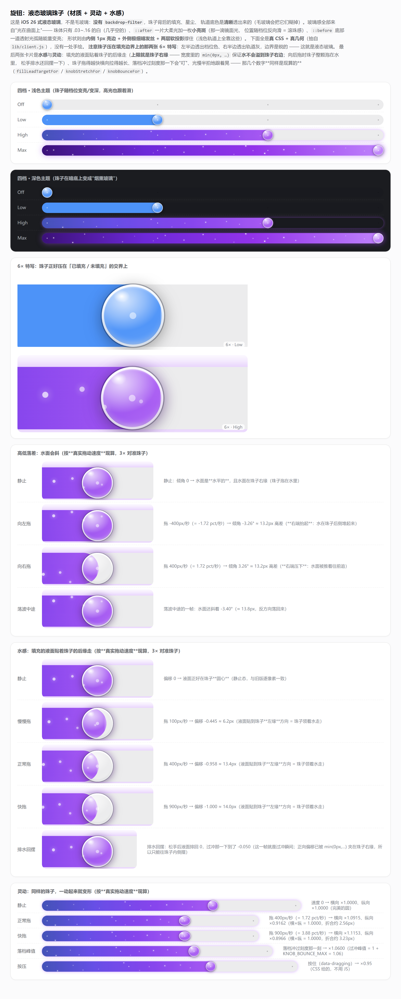

（`preview/knob-glass.html` 是可交互的静态页；两张 6× 特写故意让珠子压在"已填充/未填充"的
交界上 —— 边界在珠子里仍然是**锐利**的，这就是它和毛玻璃的区别。）

### 珠子的"灵动"

材质之外，珠子还会对手做出反应（幅度都很小 —— 要的是"灵动"，不是"炫"）：

| 动效 | 驱动 | 说明 |
|---|---|---|
| **跟手拉伸** | 瞬时速度 `velocityFor` → `knobStretchFor` | 拖得越快横向拉得越长（上限 9%，正常拖约 1px、快拖约 1.8px），纵向取 `1/(1+e)` —— **横 × 纵恒等于 1**，真的保体积 |
| **落档"叮"** | 落档动画**自己的过冲** `knobBounceFor` | 冲过刻度那一刻珠子放大到 1.06，落定精确回到 1 —— 与弹性回弹**天然同步**，没有第二个计时器 |
| **高光滞后** | `knobLagPctFor`（时间常数 90ms） | 高光跟着珠子走但慢半拍，所以"光在液体里晃"；静止时收敛到珠子本身，不会漂 |
| **内反射** | 纯 CSS `::before` | 底部那道透射光弧跟着 `--ces-energy` 变亮（高档位更明显） |
| **按压压扁** | 纯 CSS（`data-dragging`） | 按住时 ×0.95，松手交给"叮"接棒 |

四个量拼成珠子上**唯一**的 `transform`：
`scale(press × bounce) scaleX(stx) scaleY(sty)` —— 全部只动 transform（合成器友好），
几何一个像素没动；静止时这四个变量都是 1，珠子就是完美的圆（有断言）。

**速度怎么算、怎么归零**：只在**位置真的变了**的那一次渲染里推进速度与滞后 ——
拖动途中 store 变化（busy 之类）导致的重复渲染不算，否则珠子会在拖动中途突然缩回圆形；
停手 `140ms` 后由**一个 timer**把速度归零（不是动画循环），并顺带渲染一次让拉伸收回。

**降级**（沿用插件一贯的"放缓而不冻住"）：`prefers-reduced-motion` 下拉伸与"叮"的幅度减半、
按压减半、呼吸停掉。

**活泼档（默认关，一行可开）**：把 `KNOB_BREATH_ENABLED` 翻成 `true`，珠子静止时高光会极慢地
"呼吸"（4.2s、±1.2%；keyframes 已在 CSS 里、由 `data-breath` 门控）。预览页有
「玻璃呼吸（活泼档）」按钮，可以先点开看效果。

### 进度条的"水感"（液面贴着珠子的后缘走）

水的右端就是**液面**。它不再硬邦邦地钉在圆心，而是像水一样跟着珠子跑：

| 状态 | 液面在哪 |
|---|---|
| 静止 | 基准 = 珠子**右缘**（`FILL_BASE_RADIUS = 1`）→ **珠子始终泡在水里**，这就是水位**上限** |
| **向前拖**（升档） | 液面退到珠子**圆心**附近 → 珠子领着水走，水在后面追 |
| **向后拖**（降档） | 液面**顶在珠子右缘**不再外移（已到上限）→ 看上去"像灌满了一样"，水从珠子两侧鼓起来（见下一节） |
| **松手** | 液面**排回**基准位，还带一点**回摆**（过冲一下再弹回） |

> 为什么静止时是**右缘**而不是圆心：v1.0~v1.7 都是"填充到圆心"，于是珠子右半颗永远坐在裸轨道上 ——
> 用户原话"**珠子右下角一直没水**"。现在静态基准抬高一个半径，珠子整颗泡在水里；
> `lead`（±1 半径）在这个基准上前后摆动。
>
> ⚠️ **"水不能超过珠子"（用户要求）**：基准**已经**是珠子右缘，所以液面只能往**回**（左）走 ——
> v1.8.0 里向后拖会把水堆到珠子右缘**之外**一个半径（水溢到珠子右边），现在是**硬上限**：
> 水最多停在右缘、把珠子整颗泡住。上限夹在 **CSS** 里（`min(0px, …)`）而不是 JS 里，这样
> `fillLead`/`fillSkewTargetFor` 这些物理量保持自然值（荡波仍双向振荡），断言也能分头验
> "物理量"与"显示上限"两件事。

实现（全部复用既有机制，**没有新循环**）：

- **目标**：`fillLeadTargetFor(velocity) = −FILL_LEAD_MAX × tanh(v / FILL_VELOCITY_SOFT)` ——
  单位是**珠子半径**，`FILL_LEAD_MAX = 1`；`tanh` 天然饱和、处处连续，方向反转时液面平滑地绕过珠子，
  **不需要状态机**。注意它**不对称**：向左（升档）能退到圆心，向右（降档）被
  `min(0px, …)` 夹在珠子右缘 —— 能看见的摆动范围就是**珠子圆心 ↔ 右缘**这一整个半径；
- **追随**：`approachFor(prev, target, dt, FILL_LAG_TAU_MS = 70)` 指数逼近 ——
  "先停在珠子后缘、再继续流过去"是连续发生的，不是跳变；
- **排水**：停手（`KNOB_MOTION_STALE_MS = 140`）后，用**落档动画器**的**荡波曲线**把液面弹回 0；
- **宽度**：`calc(<到圆心> + 14px × <珠子当下的横向缩放> + min(0px, var(--ces-fill-offset)) × 14px)` ——
  宽度**只给水层**（`.ces-water`）这一层，水层内部那三层跟着水层的宽度走（水盖到哪，星就亮到哪）。
  那个 `<缩放>` 是 `--ces-press × --ces-bounce × --ces-stx`（与珠子自身用的是同一组变量，见
  "珠子压扁时水的端面也跟着变"）；`min(0px, …)` 就是上面那条 **"水不能超过珠子"**的上限；
  越界（pct=1 再加一个半径）由水层的圆角截住；
- **珠子不动**：液面只改水层那三层的宽度，珠子的位置几何一个像素没动。

**⚠️ 速度标定（一个真实踩过的坑）**：速度单位是 **pct/秒**，而 1 pct = 整条轨道（可用宽 272px）——
所以"正常拖一下"（约 400px/s）只有 **1.5 pct/秒**，快拖约 3.3、甩一下约 7。

**⚠️ 更关键的是：瞄准某一档时的真实手速只有 0.6~1.2 pct/秒。** 1 pct = 整条轨道（272px），
而"小心对准档位"意味着整条轨道要拖 800~1500ms —— 也就是 200~400px/s。所以软化尺度取 **0.9**：
连小心拖也已经到六七成幅度，而不是要你甩起来才动。现在（v1.8.0 重新标定后）：

| 拖动速度 | pct/秒 | 液面位移 | 水面落差 | 珠子拉伸 |
|---|---|---|---|---|
| 慢慢拖 100px/s | 0.37 | 5.4px | 6.2px | 0.9px |
| **小心瞄准 200px/s** | 0.74 | **9.5px** | **10.8px** | 1.5px |
| **正常拖 400px/s** | 1.47 | **13.0px** | **14.8px** | 2.4px |
| 快拖 900px/s | 3.31 | 14.0px（贴满即止） | 16px | 3.2px |

测试里有**两道**防线守着这件事：

- `section 23/24`：直接验纯函数的幅度（`soft` 常量不许回到两位数；400px/s 时落差 ≥ 14px）；
- `section 24c`（**端到端**）：走完整管线 —— 真实指针事件 → `pctAt` → `shownPct` → `velocityFor`
  （真实时间戳）→ 纯函数 → `--ces-*` 变量 —— 用 60Hz 的真实帧间隔模拟"小心瞄准档位"的拖动，
  断言落差 ≥ 8px、液面 ≥ 5px、拉伸 ≥ 1px。
  **为什么必须有这一条**：前三次"感觉没变化"里，测的要么是纯函数、要么只看符号，所以
  单位/时序一旦在真机上不同，测试照样全绿而真机看不见 —— 这条就是那次教训的防线。

「减少动态效果」下液面与落差幅度减半、排水不带过冲。**但水不止会"流"，还会"斜"和"荡"** —— 见下一节。

### 水面的高低落差（倾斜）+ 排水荡波

真实的水不会只有一条垂直的水位线：

1. **水面是一条斜线**（`--ces-skew`，**度**，±`SKEW_MAX_DEG = 3.4°` ≈ 整条轨道上 16px 高差）：
   向左拖 → 负角 → 水层绕**左端**逆时针转，**右端抬起**（水在珠子后侧堆起来）；向右拖 → 正角 → 右端压下。
   **实现方式（换过一次，原因是真机 bug）**：
   - 早先用 `clip-path: polygon()` 斜切右缘。多边形只能切直线，于是把填充**原本的圆头**切出两个尖角 ——
     用户原话"**水是畸形的**"；而且它只斜"右缘附近"，不是一条真正的水面线；
   - 现在：水**就是** `.ces-water` 这一层（`overflow:hidden` + 左端圆角 + **右端椭圆角**，宽度由液面驱动），
     里面套一层**比轨道上下各高 `WATER_PAD_PX = 20px`** 的 `.ces-water-inner`，对它用
     `transform: rotate(var(--ces-skew))` + `transform-origin: 0 50%`。竖直的右缘于是被转成一条
     **横跨整条水位、与管子同一角度的斜线**（真正的水面），右端形状由水层自己给 → **不会有尖角**；
     水层比轨道高，转 3.4° 也不会露出上下空隙；**珠子是这一层的兄弟节点**，材质与投影完全不受裁切影响。
     （注：`skewY` 做不到这件事 —— 它把竖直线还是映射成竖直线，右缘依旧是垂直的。）
   - 样式表里现在**没有任何 `clip-path`**（测试里有一条 `css.indexOf("clip-path") < 0` 守着）；
   - 水层右端是一道 `inset -1.5px 0 0` 的水面高光（水层转了，它自己也就是斜的）；
2. **排水荡波**（不是单次回摆）：松手后液面与倾角按同一条**荡波曲线**荡回静止位 ——
   `g(u) = 归一化[1 − dev(u)]`，其中 `dev(u) = e^{−λu}·(cos ωu + (λ/ω)·sin ωu)` 是
   **零初速**的阻尼振荡解。挑这个解是有原因的：早先用 `1 − e^{−λu}cos ωu` 时 `dev'(0) = −λ ≠ 0`，
   一上来就有速度 —— 真机表现是"松手后水面**啪地弹回**（80%+ 在前 15% 时长内走完）、然后再晃"，
   用户直接指出"**是荡水的问题**"。零初速解满足 `dev(0) = 1、dev'(0) = 0`，于是水面是
   "**减速停住 → 荡过静止位（约 35%）→ 收回**"，这才是水的样子。

### 珠子压扁时，水的端面也跟着变（v1.9.0，"右上角/右下角溢水"）

用户原话：**"右上角和右下角水溢出来了"** —— 珠子被按下去时会被**压扁**
（`--ces-press` × `--ces-bounce` × `--ces-stx/--ces-sty`，见"灵动"一节），轮廓从**圆**变成**椭圆**；
而水层的右端当时是一个固定的 `border-radius: 999px`（半径 14px 的半圆）。半圆比椭圆"胖"，
于是珠子上下两个角上各露出一条水边。

修法是让水层的右端**跟着珠子一起变形**：

- 新增四个派生量：`KNOB_SCALE_X = press × bounce × stx`、`KNOB_SCALE_Y = press × bounce × sty`，
  以及 `KNOB_RX = 14px × KNOB_SCALE_X`、`KNOB_RY = 14px × KNOB_SCALE_Y`（都在 `lib/client.js` 里，
  和珠子的 `transform` 用**同一组**变量 —— 不允许出现第二套形变公式）；
- 水层右端用**椭圆角**：`border-top-right-radius: <KNOB_RX> <KNOB_RY>`（下端同理）。
  两个角各占竖直方向的一半高度，于是拼成**与珠子同一个椭圆**的端面；
- 于是"水不能超过珠子"从一道**夹取**（`min(0px, …)`）升级成**几何上的相等**：
  珠子怎么压，水的端面就怎么收，回弹时再跟着张；
- 为了水层能读到这些变量，`--ces-press` 从**珠子**身上搬到了**根**
  （`.ces-inline[data-dragging='1']{--ces-press:.95}`）：否则水层继承不到 —— `--ces-stx/--ces-sty/--ces-bounce`
  同理，一并挪到根上（珠子的 `transform` 仍然读同一批变量，所以珠子本身的观感没有变化）；
- 宽度也从内层三层（填充/能量/星尘）**上收到水层一层**：内层不再各自设宽度，只负责颜色与星尘。

> **为什么不能"把水的右端做平"**：珠子压扁成椭圆后，**任何**竖直的平端面都一定会从珠子上下两个角露出来 ——
> 椭圆在竖直方向的极点在珠子**圆心**那一列，而平端面在那里已经有 14px 高，椭圆却只有 `14 × sty` 高。
> 想"一点都不露"，端面就必须是同一个椭圆；这不是审美选择，是几何结论。
> （所以 v1.8.0~v1.8.1 那个"平的端面 + 水面高光"只在珠子**不形变**时成立。）
   测试里有一条**起点斜率 < 中段峰值斜率的 40%** 的断言守着它（旧曲线必然失败：它的起点就是峰值）。

> 早先还挂过一个"水舌"（`.ces-meniscus`）小元素 —— 它 `bottom:0` + 几像素高，真机实测被用户读成
> "轨道底下趴着一小块水"，已**删除**；水面的表达交给上面这两条（斜切 + 高光）。

**每一荡都不一样**（用户要的"随机"）：`sloshSpecFor(种子)` 给出这一荡的
**时长（300~520ms）/ 波数（1.1~2.1）/ 阻尼（2.2~3.6）/ 水量（1.0~1.4）**，
种子把"第几次排水 + 当时的液面/倾斜"混进去。用**确定性哈希**而不是 `Math.random`：
同一个种子结果可复现（否则离线断言没法写、操作重放也会不一致）。
"水量"是用**幂次**放大"偏离静止位"的那部分（`1/amplitude < 1` → 波峰更高、波谷更深），
所以端点仍然精确 0 / 1；「减少动态效果」下退化成干净的 ease-out（**没有波**，放缓而不冻住）。

| 状态 | 水面 |
|---|---|
| 静止 | 平 + 无落差（与旧版逐像素一致） |
| 向左拖 | 液面停在珠子右缘（泡住珠子）+ **右高左低** |
| 向右拖 | 液面贴珠子左缘（领着水走）+ 左高右低 |
| 松手 | 液面与倾斜一起**荡两下**（每次时长/波数/水量都不同）再收回平位 |

## 落档（松手吸附 + 弹性回弹）

拖动全程**连续跟手**（旋钮、填充、能量、星尘都跟着指针走），松手那一帧做两件互不干扰的事：

1. **先写回档位**：`directory.select({ provider, model, reasoningEffort })`，目标是 `indexFromPct(pct)`
   （四舍五入到**最近档位**）。时机、去重、降频、在途合并、超时回滚**全部与旧版一字不差** ——
   动画不参与写回，也不会因此多写一次。
2. **再播放落档动画**：从松手位置沿纯函数曲线弹性吸附到该档位的刻度。

| 量 | 值 / 位置 |
|---|---|
| 时长 | `SNAP_DURATION_MS = 420`；「减少动态效果」时 `SNAP_DURATION_REDUCED_MS = 180` |
| 回弹幅度 | `SNAP_OVERSHOOT = 0.1`（相对"松手点 → 刻度"的行程，即冲过约 10% 再弹回来） |
| 曲线 | `snapEaseFor(u, reduced)`：正常 = easeOutBack（二分反解 `c`，使回弹**正好**等于上面那个数，单一真相）；reduced = ease-out，**不回弹** |
| 位置 | `settlePctFor(from, to, elapsed, reduced)`，末尾 `clamp01` 收口 —— 回弹再大也不会把旋钮顶出轨道两端 |
| 驱动 | `createSnapAnimator`：rAF 优先 → `setTimeout(16ms)` 回退 → 两者都没有就**瞬时落档**（fail-open，退化成旧行为） |
| 时钟 | `window.performance.now()`（没有就用 `Date.now`）；测试台因此能用**假时钟**断言逐帧序列 |

因为填充色、能量强度、粒子数、刻度、旋钮位置、文字颜色**全是 `shownPct` 的纯函数**，
动画只需要驱动这一个值，六处视觉量就自动同步 —— 不需要给每个元素各写一套动画。

`easeOutBack` 的值只在 `u=1` 回到 1.0，所以越过刻度之后**整段回落都是贴着刻度从上方**接近，
到终点才精确落上去：这就是"弹一下再停住"的手感来源。

**打断与改道**（每条都有断言）：

- 落档途中再按下 → 立刻取消动画，草稿接管显示（不让动画和手指抢旋钮）；
- 落档途中写回**失败/超时** → 从**当前位置**再弹一次到真实档位（而不是闪一下跳过去）；
- 落档途中档位表变了（换模型）→ 取消动画，显示交回生效值；
- 组件卸载 / 关菜单 → 取消挂着的帧，不会在卸载后 `setState`；
- 键盘换档（`←`/`→`、`Home`/`End`）与滚轮换档走**同一套**弹性落档（见下一节）；
- 初次挂载与"外部改档"（官方菜单别处改了档）**不做动画**，直接显示生效值。

拖动期间根节点带 `data-dragging="1"`，把能量层/星尘那两层 `opacity` 过渡关掉（跟手要"脆"）；
落档期间带 `data-settling="1"`，此时保留过渡（能量渐入更顺，也盖住回弹那一小段）。

想看它的形状：`preview/snap-frames.html`（可交互无关，纯静态图解）与
[`preview/snap-frames.png`](preview/snap-frames.png) —— 上半是位置-时间曲线（正常 vs reduced），
下半是同一段落档的 10 帧胶片（每帧都写明位置、与刻度的偏差、星数与能量）。

## 键盘与滚轮（一档一档，到端点钳住）

**只要模型菜单开着就生效**（不必先点滑条）：

| 输入 | 行为 |
|---|---|
| `←` / `→` | 档位 **-1 / +1**，走**同一套弹性落档**动画 |
| `↑` / `↓` | 模型在 **Flash ↔ Pro** 之间切（两个方向行为相同，只有这两个） |
| `Home` / `End` | 跳到最低 / 最高档 |
| 悬停滑条时滚轮 | 向上滚 = 升一档、向下滚 = 降一档（一格一档） |
| `Esc` / `Enter` / `Tab` | 交给官方菜单（照旧） |

**为什么不是"焦点在滑条上才生效"**（v1.2.1 的修正）：官方菜单自己管焦点，打开菜单后焦点在它的
`menuitem` 上，按键根本到不了滑条 —— 于是"必须先点一下滑条"这条件既不好发现也不好用。
现在键盘挂的是 **document 捕获阶段**的监听，作用范围是"菜单开着 + 事件目标/焦点在菜单里
（或刚点开菜单的那颗席按钮上）"：

- 捕获阶段先于 React 挂在根容器/portal 容器上的合成监听 → 先处理、再 `stopPropagation`
  拦住官方菜单（所以 `↑`/`↓` 不会同时又去移焦点）；
- 目标是输入框/文本域时**一律不接管**（子面板里有搜索框，而且那时滑条已经摘了）；
- 菜单关掉（桥摘掉）或 `locked` 会话 → 监听立刻失效，键盘完全归官方；
- 菜单**之外**的按键（比如在输入框里移动光标）完全不受影响。

这套依赖的平台语义在真浏览器里逐条自查过（`document` 捕获先于 portal 容器上的监听、
`stopPropagation` 真能拦住它、`preventDefault` 真能取消方向键默认行为、菜单外的键不被碰）。

三条纪律，都是为了"**Pro 的 Max 很贵**"这件事：

1. **不环绕**：到 `Off` 再往左、到 `Max` 再往右，都**停在端点**（不会绕回另一端）——
   一次长滚/长按绝不会把你从最低档甩到最贵的那一档。
2. **一次最多一档**：滚轮先把三种 `deltaMode` 归一化成"格"
   （像素 100px/格、行 3 行/格、页 1 事件/格），再进累积器；**每个事件最多走一步**，
   累积器钳在 ±1 —— 触控板连续小增量不会"机枪扫档"。
3. **不刷后端**：滚轮走**限频**写回（键盘是即时），连滚 6 格通常只打一次宿主；
   与档位共用一条在途槽（`1 在途 + 1 排队`），并在发送前做第二道去重。

**滚轮不会连带滚页面/菜单**：React 的 `onWheel` 是 passive 的（`preventDefault` 无效），
所以插件在桥注入的容器上挂**原生非 passive** 监听；处理了就 `preventDefault` + `stopPropagation`。
`locked` 会话或正在拖动时**不接管**滚轮（页面照常滚，也不换档）。

**切模型 = 官方语义**：`↑`/`↓` 发的是与官方**模型行**一字不差的载荷
`directory.select({ provider, model })`（**不带** `reasoningEffort`）——所以**档位原样保留**：
`Flash + Max` 按 `↑` 就是 `Pro + Max`（要省就自己按 `←` 降档）。模型切换**不做乐观显示**，
等目录回报（失败就照旧在那一行下面显示原因）；也**不播落档动画**（档位表可能随模型变）。

**认不出就什么都不做**：目录里没有 id 含 `flash` / `pro` 的模型时，`↑`/`↓` 完全不动
（`toggleModelFor` 返回 null，纯函数有断言）。

## 稳健性（每条都有断言）

- `directoryFor()` 在会话作用域就绪前**按设计抛错** → 退避重试（60ms 起，约 9 秒）+ 自愈；
  档位数是**后到**的，桥会在档位数变化时主动重扫（DOM 不会因为 store 变化而产生 mutation）。
- 写入失败 / 超时（10s）→ 回滚到真实档位并显示原因，**不谎报成功**。
- 拖动写入有**同档位去重 + 在途合并 + 120ms 降频**：1 秒内 60 次拖动最多 3 次写回，
  落在当前档位时 0 次；松手必定落地。
- 滑条吞掉自己的 pointer/click/方向键事件，**不会误触官方那一行的 onClick**（那会跳进等级列表）。
- 组件卸载时清掉降频定时器；桥卸载时还原那一行的样式并摘掉容器。
- 落档动画**只驱动显示**：写回次数、时机与旧版逐条比对过（有断言），动画期间 0 次多余写回。
- 落档途中写回失败 → 动画**改道**回真实档位；档位表变化 → 取消动画；卸载 → 取消挂着的帧。
- 没有 `requestAnimationFrame` 也不影响功能：退化成 `setTimeout` 逐帧；连计时器都没有就**瞬时落档**。

## 开发

无构建步骤：`lib/client.js` 就是发布产物（手写、可读，`require("react")` 与 `require("react-dom")`
走宿主模块表的平台种子词）。

```powershell
npm test              # 离线断言套件（636 项：几何/色彩/星空/注入/失败回滚/落档/键盘/滚轮/材质/灵动/水感/落差/荡波/端到端量级/无注入回归）
npm run preview       # 生成 preview/panel.html（可拖、可滚、可按键、可切 Flash/Pro）
npm run preview:snap  # 生成 preview/snap-frames.html（落档逐帧图解）
npm run preview:knob  # 生成 preview/knob-glass.html（旋钮材质特写）
```

测试台 `test/harness.mjs` 里有一份**保状态**的 React 桩、够用的假 DOM（含 portal、MutationObserver、
多属性选择器、节点级 `addEventListener/dispatch`）、一个**假官方菜单**（形状逐字对齐官方产物）、
**假时钟 + 手动帧泵**，以及一个**两个模型的假目录**（Flash + Pro，与真机同一份 4 档）——
落档动画的断言是"逐帧看 DOM"的：推一帧、读旋钮的 `left`、再推下一帧，所以能直接断言
"冲过刻度 → 回落到刻度 → 精确停住"这条序列，而不是只看起点终点；滚轮则是往容器上派发
**原生 `wheel` 事件**，连"事件被 `preventDefault` 了吗"都断言得住。

假宿主的 `select` 与真机**逐条对齐**：带了 `model` 就切模型，**没带 `reasoningEffort` 就不动档位**
（官方模型行就是这么切模型的）——所以"切模型不改档位"测的是真行为，不是桩件的巧合。

第 12 节断言会**直接读解包出来的官方产物**校验那 4 个语义锚点还在（`aria-haspopup` / `aria-expanded` /
`aria-controls` / `role="menuitem"` + 官方文案 + `resize` 重测），官方改版导致锚点漂移时会先炸测试，
而不是静默失效。本机没有解包产物时该节自动跳过（本机真实产物在
`resources\app\node_modules\@deepseek-ai\dsh-client-ui-model-selection\lib\client.js`，可加进候选列表）。

### 重生成 `snap-frames.png`

`preview/snap-frames.png` 是 **`snap-frames.html` 的无头浏览器截图**（页面本身是静态 HTML，
数学全靠抽产物的函数在生成期算好）。任何 Chromium 都可以：

```powershell
node preview/make-snap-figure.mjs
msedge --headless=new --disable-gpu --hide-scrollbars --force-device-scale-factor=2 `
  --window-size=1200,1220 --virtual-time-budget=2500 `
  --screenshot=preview/snap-frames.png "file:///<仓库绝对路径>/preview/snap-frames.html"
```

（`--user-data-dir=<临时目录>` 可以避免和正在运行的浏览器抢配置目录。）

### 重生成 `knob-glass.png`

同理，`preview/knob-glass.png` 是 `knob-glass.html` 的无头截图（换尺寸即可）：

```powershell
node preview/make-knob-figure.mjs
msedge --headless=new --disable-gpu --hide-scrollbars --force-device-scale-factor=2 `
  --window-size=1000,1180 --virtual-time-budget=2000 `
  --screenshot=preview/knob-glass.png "file:///<仓库绝对路径>/preview/knob-glass.html"
```

## 已知限制

- 需要重启 DSH Desktop 才生效（客户端 bundle 在启动时注入）。
  **怎么看自己跑的是哪一版**：鼠标停在滑条上，提示气泡最尾就是版本号（`… · v1.9.0`）——
  测试会断言它和 `package.json` 一致，所以不会忘同步。
- 控制项活在官方菜单里，所以**必须先点开模型菜单**才能改档位；输入框工具行上没有常驻读数。
- 依赖官方菜单的 DOM 语义属性。官方若改成非 `menuitem` 结构、去掉 `aria-controls`、
  或不再用 `data-composer-card`，本插件会**静默退回"什么都不做"**（官方菜单照常可用）。
- 那一行加高约 20px + 滑条 28px，菜单总高会变大；官方会自己重测位置，但极小屏幕上可能出现
  菜单贴边（官方自身的 `max-height` 与夹取逻辑仍在）。
- 主题令牌缺失时回退到中性灰 + `#4d93f8` 蓝，观感可用但不如在 DSH 内贴合。
- **模型菜单开着时 `↑`/`↓` 被本插件占用**（切模型），所以官方菜单自带的"上下键移焦点"
  在这个菜单里不再生效（`Esc`/`Enter`/`Tab` 照旧，想用官方导航就先把菜单关掉）——
  这是刻意的键位分配。
- **悬停在滑条上时滚轮归滑条**（不滚页面/菜单）。想滚页面就把指针移开那 28px；
  `locked` 会话与拖动过程中不接管滚轮。
- 落档是**纯视觉动画**：写回在松手那一刻就发出去了，动画只是把"落在哪一档"演出来。
  所以写回失败时，读数会先停在用户点的那一档，等动画**改道**回真实档位（最长约 420ms）才回滚显示 ——
  中途错误提示已经出现（不谎报成功），只是显示回滚跟着动画走。
- 落档期间会临时占用 `left`/`width` 两个内联样式（与拖动时同一套几何），所以官方那一行的
  "测量后固定定位"若在动画中途重排，动画会跟着重排后的轨道走（几何每次都现算，不留缓存）。
- 极端环境（既没有 `requestAnimationFrame` 也没有计时器）下**没有动画**，直接跳到刻度上 ——
  功能正确性优先，观感降级。

## 致谢 / Credits

本插件是 **`dsh-codex-effort-slider`** 的修改版（起点是它的 v1.0.0）：

| 项 | 上游 |
|---|---|
| 作者 | [Microqian2th](https://github.com/Microqian2th)（npm 发布者 `microqian`） |
| 仓库 | [github.com/Microqian2th/dsh-codex-effort-slider](https://github.com/Microqian2th/dsh-codex-effort-slider) |
| npm | [`dsh-codex-effort-slider`](https://www.npmjs.com/package/dsh-codex-effort-slider) |
| 许可 | MIT（`Copyright (c) 2026 dsh-codex-effort-slider contributors`） |

在它的基础上改动的主要是：**改名为 `dsh-glass-effort-slider`**；键盘 `←`/`→` 逐档
（到端点钳住、不环绕）、`↑`/`↓` 切 Flash↔Pro（档位保留）、`Home`/`End` 跳两端、悬停滚轮调档；
松手后的**弹性吸附落档**动画；珠子改为**液态玻璃材质**（不用 `backdrop-filter`）＋速度驱动的
横向拉伸与落档回弹；填充端改为**真水面**（横跨整管的水管层、随速度倾斜的落差、松手后的随机
荡波、且水不越过珠子右缘）；滑条 `title` 尾部常驻版本号。

原插件的拖动映射、档位颜色/能量/星尘那套色彩逻辑仍是上游设计（README 里「色彩与粒子」一节
基本是它的原文）。

## 许可

MIT —— 同时保留上游与本仓库的版权声明，见 [`LICENSE`](LICENSE)（正是 MIT 要求的那一条：
"the above copyright notice and this permission notice shall be included in all copies"）。
本插件不含第三方运行时代码：闪电标/雪弗龙是自己画的路径，粒子层是自己写的 DOM/CSS；
`preview/screenshots/` 里的真机截图沿自上游。
